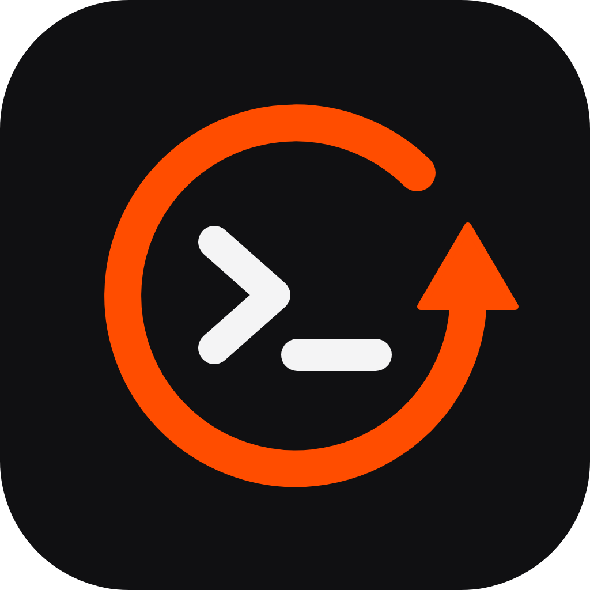
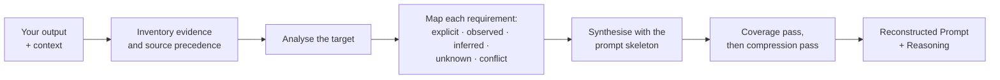

<p align="center">
  
</p>

<h1 align="center">Reverse Prompt Engineer</h1>

<p align="center">
  <b>Reconstruct the prompt behind any AI output: faithfully, with the evidence shown and the uncertainty stated.</b><br>
  An Agent Skills plugin for Claude Code, OpenAI Codex, Claude.ai and other Agent Skills hosts.
</p>

<p align="center">
  <a href="https://github.com/Suraj-Dhal/reverse-prompt-engineer/actions/workflows/ci.yml"></a>
  <a href="https://github.com/Suraj-Dhal/reverse-prompt-engineer/releases/latest"></a>
  <a href="LICENSE"></a>
  <a href="https://agentskills.io/specification"></a>
</p>

---

You have a great AI-generated report, post, code sample or image, but not the prompt that made it. Maybe an intern wrote it and left, maybe the chat is gone, maybe you want to turn a one-off result into something repeatable. **Reverse Prompt Engineer** studies the output and whatever context you have, and gives you back **one copy-ready prompt** that can reproduce it, together with an honest account of what is evidence, what is inference and what is unknown.

It will never pretend to recover "the exact prompt": nothing can do that from an output alone. It reconstructs a prompt you can actually use, and tells you how much to trust it.

## Example

> **You:** We're a small CA firm. Our intern wrote this LinkedIn post with ChatGPT and has since left. What prompt would make posts like this for our next events?
>
> *(pastes a post announcing a free GST workshop: emoji hook, three ✅ bullets, 📍 venue line, 🎟️ "only 40 seats", hashtags)*

**Reverse Prompt Engineer** (abridged):

````markdown
## Reconstructed Prompt

```text
ROLE
You are the social media writer for Mohanty & Associates, a small chartered accountancy firm in Bhubaneswar.
TASK
Write a LinkedIn post announcing our free workshop on {{TOPIC}}.
EVENT DETAILS (use exactly as given)
Date: {{DATE}}   Time: {{TIME}}   Venue: {{VENUE}}   Seats: {{SEAT_COUNT}}
OUTPUT FORMAT
1. A hook line that starts with one emoji and asks whether the reader's business is ready. …
3. "What you'll learn:" followed by exactly three ✅ bullets …
CONSTRAINTS
Under 100 words, excluding hashtags. Do not state legal deadlines unless they appear in the verified facts below …
```

## Reasoning

1. **Observable clues:** emoji-led hook; exactly three ✅ bullets; a 📍/🕓 logistics line; …
2. **Likely intent:** a reusable event-promotion post …
3. **Context preserved:** firm, city, audience, free format; the date and seats became placeholders …
4. **Prompt-design factors:** the numbered format reproduces the six-part structure …
5. **Confidence and limits:** Overall confidence: Moderate. The claim that e-invoicing "is now mandatory for more MSMEs" is unverified …
````

See the full version and two more examples (code, and an instruction audit) in [`worked-examples.md`](skills/reverse-prompt-engineer/references/worked-examples.md).

## What it can do

| | |
|---|---|
| 🔁 **Reconstruct** | One prompt behind a report, article, analysis, code, image, design or website copy |
| 🧵 **Rebuild master prompts** | From a long conversation plus files, keeping every still-valid earlier requirement |
| 🧩 **Unify** | One prompt that reproduces several related outputs |
| ✅ **Audit** | Which of your original instructions an output followed, partly followed or missed, then reconstruct |
| ✨ **Improve (optionally)** | Suggestions labelled "not evidence", so they're never confused with the reconstruction |
| 🌐 **Any language** | The prompt reproduces the target's language; the explanation uses yours |
| 🛡️ **Stay safe** | Ignores instructions hidden in the material, keeps unrelated personal details out, won't rebuild prompts for phishing or other harm |

## Install

**Claude Code** (2.1.275+):

```text
/plugin install reverse-prompt-engineer --marketplace Suraj-Dhal/reverse-prompt-engineer
```

**OpenAI Codex:**

```bash
codex plugin marketplace add Suraj-Dhal/reverse-prompt-engineer
codex plugin add reverse-prompt-engineer@suraj-dhal
```

**Claude.ai / Claude apps:** download `reverse-prompt-engineer-<version>-skill.zip` from [Releases](https://github.com/Suraj-Dhal/reverse-prompt-engineer/releases/latest), then go to **Settings → Capabilities → Skills → Upload skill**.

Older Claude Code versions, other hosts, updating, pinning and uninstalling are covered in **[docs/installation.md](docs/installation.md)**.

## Use

Paste an output and ask, in your own words:

- "What prompt could have produced this?"
- "I lost the prompt for this report. Rebuild it from the final document."
- "Rebuild the master prompt from our chat and these notes."
- "Here's my prompt and the result. Which instructions did it miss? Then give me a prompt that reliably produces this."

Every answer has the same shape: **Reconstructed Prompt** (one block; fill in any `{{PLACEHOLDERS}}`) and **Reasoning** (five labelled points ending in an overall confidence of High, Moderate or Low). See **[docs/usage.md](docs/usage.md)** for modes, tips and troubleshooting.

## How it works



The skill loads progressively: a short description at startup, the core instructions when activated, and focused playbooks (domain checks, context preservation, evidence calibration, safety, advanced procedures) only when a situation calls for them. **[docs/how-it-works.md](docs/how-it-works.md)** explains the workflow, the evidence model, the output contract, the safety model and the design decisions.

## Quality

Prompt-based software regresses silently, so every promise above is backed by a check:

| Layer | What it checks | Where |
|---|---|---|
| **Structural validation** | All four manifests valid and consistent, Codex listing limits, `SKILL.md` frontmatter and size, every playbook reachable, fixtures well-formed, licence, links | `scripts/validate.py` (12 checks) |
| **Official validator** | Claude Code's own plugin and marketplace validation, strict mode | `claude plugin validate . --strict` in CI |
| **Unit tests** | Validator, response linter, eval builder, packaging, version bumps; regression tests for each v0.2.0 bug | `tests/` (Linux and Windows, Python 3.9–3.13) |
| **Contract linting** | Worked examples, and any saved response, match the output contract | `scripts/lint_response.py` |
| **Behavioural evals** | 65 live cases: 40 activation (trigger) tests, 25 behaviour tests covering conflicts, provenance, domains, modes, multilingual, injection, privacy, hidden-prompt requests and unsafe objectives | `evals/`, run with `claude plugin eval` |

The latest live results, and how to reproduce them, are in **[docs/evaluation.md](docs/evaluation.md)**.

## Repository layout

```text
.
├── plugin.json                      Agent Plugins manifest (+ OpenAI listing metadata)
├── .codex-plugin/plugin.json        OpenAI Codex manifest
├── .claude-plugin/                  Claude Code manifest and marketplace
├── assets/                          Icon (PNG + SVG source)
├── skills/reverse-prompt-engineer/  ← the skill (the only part loaded at runtime)
│   ├── SKILL.md
│   ├── references/                  playbooks and worked examples
│   └── assets/                      prompt skeleton, evidence matrix
├── evals/                           behavioural suite (fixtures → generated cases)
├── scripts/                         validate, lint, build evals, package, bump version, release notes
├── tests/                           unit tests
├── docs/                            documentation
└── .github/                         CI, release and live-eval workflows; templates
```

## Development

```bash
python3 scripts/validate.py                     # structural validation
python3 -m unittest discover -s tests           # unit tests
python3 scripts/build_evals.py                  # regenerate the eval suite after editing fixtures
claude plugin eval . --tag smoke --runs 1 --ablation none   # quick live check (costs a little)
python3 scripts/package.py                      # build reproducible release ZIPs
```

Python 3.9+ standard library only. See **[CONTRIBUTING.md](CONTRIBUTING.md)**.

## Documentation

| Document | Contents |
|---|---|
| [How it works](docs/how-it-works.md) | Architecture, workflow, evidence model, output contract, safety, design decisions, limitations |
| [Installation](docs/installation.md) | Every host, updating, pinning, uninstalling |
| [Usage](docs/usage.md) | How to ask, what to provide, reading the answer, tips, troubleshooting |
| [Evaluation](docs/evaluation.md) | Test layers, live results, running evals, cost, adding cases |
| [Licensing](docs/licensing.md) | What MIT allows and requires, what it covers, trademarks, FAQ |
| [v0.2.0 review](docs/review-v0.2.0.md) | The engineering review behind v1.0.0 |
| [Changelog](CHANGELOG.md) · [Security](SECURITY.md) · [Contributing](CONTRIBUTING.md) | |

## License

Released under the **[MIT License](LICENSE)**. Copyright © 2026 Suraj Dhal.

You may use, copy, modify, merge, publish, distribute, sublicense and sell this software, commercially or not, provided the copyright and licence notice is kept in all copies or substantial portions. It is provided "as is", without warranty. Read **[docs/licensing.md](docs/licensing.md)** for a plain-language guide, including what the licence covers, your outputs, and trademarks.

This is an independent project. It is not affiliated with or endorsed by Anthropic or OpenAI. "Claude", "Codex" and related names are trademarks of their respective owners.

## Author

**Suraj Dhal**: [surajdhal.com](https://surajdhal.com) · [GitHub @Suraj-Dhal](https://github.com/Suraj-Dhal) · surajbbsr2007@gmail.com
